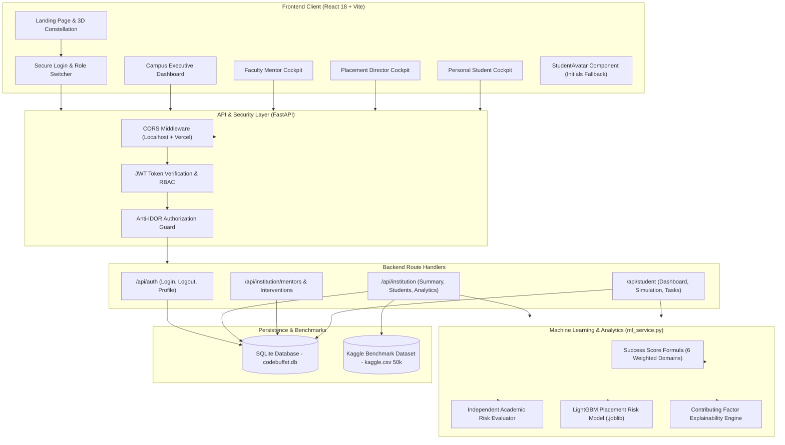

# CODEBUFFET — AI-Powered Student Analytics Platform

> **AI-Powered Student Analytics & Success Intelligence Platform**  
> Developed for Hackcelerate Challenge #04 (Student Analytics & Success Platform) in association with KPMG in India.  
> **Repository:** [https://github.com/srikeerthiyaganti-hue/AI-POWERED-STUDENT-ANALYTICS](https://github.com/srikeerthiyaganti-hue/AI-POWERED-STUDENT-ANALYTICS)

---

## Table of Contents

- [Project Title and Overview](#project-title-and-overview)
- [Key Features](#key-features)
- [Technology Stack](#technology-stack)
- [System Architecture](#system-architecture)
- [Project Folder Structure](#project-folder-structure)
- [Prerequisites](#prerequisites)
- [Installation and Setup](#installation-and-setup)
- [Running the Project](#running-the-project)
- [Database and Student Data](#database-and-student-data)
- [Machine Learning and Analytics](#machine-learning-and-analytics)
- [API Documentation](#api-documentation)
- [Testing](#testing)
- [Deployment](#deployment)
- [Demo Accounts](#demo-accounts)
- [Troubleshooting](#troubleshooting)
- [Future Improvements](#future-improvements)
- [Contributing](#contributing)
- [License](#license)
- [Acknowledgments](#acknowledgments)

---

## Project Title and Overview

**CODEBUFFET** is a full-stack, data-driven student success intelligence platform engineered for higher education institutions. Rather than functioning as a passive reporting dashboard, CODEBUFFET synthesizes multidimensional student data across academics, placement readiness, attendance, LMS velocity, technical skills, and campus engagement into actionable, transparent decision support.

### Institutional Mission & Purpose
- **Holistic Student Telemetry:** Consolidates fragmented academic performance, laboratory scores, attendance logs, and learning management telemetry into unified student profiles.
- **Early Warning & Risk Detection:** Decouples academic attrition risk from placement conversion risk, alerting faculty and mentors before student difficulties escalate into course failures or placement disqualifications.
- **Explainable Decision Support:** Delivers clear, human-readable contributing factors for every risk flag rather than opaque black-box scores.
- **Intervention Sandbox & Tracking:** Provides department heads and mentors with closed-loop mentoring tasks and cohort simulation tools to forecast the impact of targeted remediation programs.

---

## Key Features

### Implemented Features (Verified in Codebase)

- **Campus Executive Dashboard (`/institution/dashboard`):**
  - High-level KPIs: Average Student Success Score, Average CGPA, Academic Warning Roster count, and Placement Readiness rate.
  - Interactive multi-department filtering across Computer Science, Information Technology, Electronics, Electrical, Mechanical, and Civil Engineering.
  - Cohort success score distribution and historical trend visualization using Recharts.
  - Interactive 3D Spatial Campus digital twin experience with departmental telemetry hotspots.
  - Closed-loop Intervention Sandbox for tracking active mentoring assignments and priority action items.
  - One-click dynamic cohort simulation modeling the impact of attendance interventions and technical bootcamps.

- **Student Directory & 360-Degree Profile Drawer:**
  - Real-time searchable directory restricted to 50 active records for rapid responsiveness, with support for server-side department and risk filtering.
  - 360-Degree student diagnostic drawer presenting detailed multidimensional telemetry, assigned faculty mentor, data completeness rating, and academic history.
  - Live CSV export endpoint streaming filtered student cohorts directly from the database.

- **Faculty Mentor Dashboard (`/mentor/dashboard`):**
  - Dedicated mentee caseload view filtered to assigned students (e.g., Computer Science cohort under Prof. Vihaan Singh).
  - Diagnostic action profiles showing LMS submission velocity, coding assessment marks, and active backlogs.
  - Task creation and completion status toggles for mentoring interventions.

- **Placement & Career Readiness Dashboard (`/placement/dashboard`):**
  - Placement cohort segmentation across Tier-1 Dream (>12 LPA), Tier-2 Core (6–12 LPA), and Skill Acceleration tiers.
  - Telemetry tracking DSA benchmarks, technical coding scores, aptitude ratings, and mock interview readiness.

- **Personal Student Cockpit (`/student/dashboard`):**
  - Anti-IDOR protected student cockpit presenting personal success scores and component breakdown.
  - Interactive "What-If" score simulator slider allowing students to forecast their composite score based on targeted attendance and coding practice goals.
  - Checklist of active mentoring tasks with real-time status toggling.

- **Profile Pictures with Graceful Fallback (`StudentAvatar`):**
  - Curated, professional portrait photography rendered deterministically across table rosters and inspection drawers.
  - Error-resilient fallback (`onError`) generating unique, initials-based badges with hash-derived color gradients (e.g., `S27` for *Student 00027*, `AV` for *Ananya Verma*).

- **Enterprise Security & Authentication:**
  - Cryptographic password hashing using PBKDF2-HMAC-SHA256 with per-user 16-byte random salts and 100,000 iterations.
  - HMAC-SHA256 signed JSON Web Tokens (JWT) with role-based access control (`admin`, `mentor`, `tpo`, `student`).
  - Strict Anti-IDOR verification preventing unauthorized cross-student telemetry inspection.

### Planned Features (Identified as Architecture Roadmap)

- Push notifications and automated email dispatches for critical attendance alerts (<75%).
- Automated Canvas/Moodle LMS API connectors for continuous weekly telemetry ingestion.
- Student resume PDF parser extracting real-time project skills into the placement engine.

---

## Technology Stack

| Layer | Technology | Version | Purpose in Codebase |
|---|---|---|---|
| **Frontend Framework** | React | `^18.3.1` | Component architecture and state management |
| **Build Tool & Bundler** | Vite | `^5.4.2` | Fast HMR dev server and production asset bundling |
| **Routing** | React Router DOM | `^6.26.2` | Client-side routing, protected routes, and navigation |
| **Data Visualization** | Recharts | `^2.12.7` | Reactive area charts, pie charts, and bar charts |
| **UI Icons** | Lucide React | `^0.441.0` | Accessible iconography across all dashboards |
| **Styling** | Vanilla CSS | W3C Standard | Design token system (`tokens.css`, `global.css`) |
| **Backend API** | FastAPI | `latest` (0.100+) | Asynchronous RESTful API framework |
| **ASGI Web Server** | Uvicorn (standard) | `latest` | High-performance production ASGI server |
| **Database** | SQLite | 3.x | Persistent relational storage (`backend/codebuffet.db`) |
| **Machine Learning** | LightGBM / Scikit-Learn | `latest` | Gradient-boosted decision trees and feature scalers |
| **Data Processing** | Pandas & NumPy | `latest` | Cohort dataset ingestion and vector normalization |
| **Model Serialization** | Joblib | `latest` | Serialized model loading (`models/*.joblib`) |
| **Security & JWT** | PyJWT & Hashlib | `latest` | PBKDF2 password hashing and JWT HS256 tokens |
| **Testing** | Pytest & Starlette TestClient | `^9.1.1` | Automated backend integration and security test suite |

---

## System Architecture

CODEBUFFET employs a decoupled, three-tier architecture connecting a React single-page application (SPA), an asynchronous FastAPI backend service, an embedded SQLite relational database, and an in-memory machine learning inference engine.



---

## Project Folder Structure

```
CODEBUFFET-git/
├── AGENTS.md                  # Project rules and agent instructions
├── README.md                  # System overview and operational guide
├── requirements.txt           # Python backend dependencies
├── kaggle.csv                 # 50,000-record benchmark student dataset
├── ml_service.py              # ML scoring formulas, LightGBM inference & explainability
├── .env.example               # Template for environment variables and secrets
├── backend/                   # FastAPI backend application
│   ├── main.py                # FastAPI entry point, CORS middleware, lifespan
│   ├── database.py            # SQLite schema initialization, seed loader, queries
│   ├── auth.py                # PBKDF2 password hashing & JWT token functions
│   ├── seed.py                # Standalone database seeder script
│   ├── codebuffet.db          # SQLite persistent database (50,008 records)
│   ├── routes/                # Modular REST route handlers
│   │   ├── auth_routes.py         # Login, logout, user profile endpoints
│   │   ├── institution_routes.py  # Summary, students, mentors, interventions, export
│   │   └── student_routes.py      # Student cockpit, dynamic simulation, tasks
│   └── scripts/               # Ingestion and synchronization utilities
│       ├── import_csv.py          # Idempotent CSV sync with continuous attendance
│       └── import_dataset.py      # Universal CSV/Excel/JSON dataset reconciliation
├── docs/                      # Technical reports, data dictionaries, and audits
│   ├── DATA_DICTIONARY.md         # Field-level schema definitions
│   ├── DATA_RECONCILIATION_REPORT.md # SQLite vs Kaggle dataset audit
│   ├── METHODOLOGY.md             # Mathematical formulation of scoring and risk
│   ├── SECURITY_AND_CREDENTIALS.md# Password hashing, RBAC, and credentials guide
│   └── FINAL_VERIFICATION_REPORT.md # System verification and audit sign-off
├── Frontend/                  # React single-page application (Vite)
│   ├── package.json           # Frontend package manifests and scripts
│   ├── vite.config.js         # Vite bundler configuration
│   ├── index.html             # HTML entrypoint
│   ├── public/                # Static assets, backgrounds, and icons
│   │   ├── images/                # Background art (`landing-bg.png`, `signin-bg.png`)
│   │   └── favicon.svg            # Platform favicon
│   └── src/                   # React application source code
│       ├── main.jsx               # Application mount point
│       ├── App.jsx                # Router configuration and global routes
│       ├── components/            # Reusable UI components
│       │   ├── common/                # BrandLogo, StudentAvatar
│       │   ├── layout/                # PublicNavbar, PublicFooter
│       │   ├── landing/               # 3D Campus Experience, Domain Constellation
│       │   └── ui/                    # Button, Card, Badge, MetricStat, Input
│       ├── context/               # AuthContext (JWT session state & demo login)
│       ├── pages/                 # Role-based cockpit pages
│       │   ├── public/                # LandingPage, LoginPage
│       │   ├── institution/           # CampusDashboard, MentorDashboard, PlacementDashboard
│       │   └── student/               # StudentDashboard
│       ├── services/              # API abstraction layer (Axios-free fetch wrapper)
│       └── styles/                # CSS design tokens and global stylesheet
├── models/                    # Serialized machine learning models
│   ├── academic_risk_model.joblib # Academic risk model artifact
│   ├── placement_risk_model.joblib# LightGBM placement risk model artifact
│   ├── feature_scaler.joblib     # Scikit-learn StandardScaler artifact
│   └── model_metadata.json        # Feature column schema and model registry data
└── tests/                     # Automated test suites
    └── test_backend.py        # 26 backend regression, RBAC, and anti-IDOR tests
```

---

## Prerequisites

Before setting up CODEBUFFET, verify that your environment meets the following requirements:

- **Operating System:** Windows 10/11, macOS, or Linux (commands below formatted for Windows PowerShell).
- **Python:** Version `3.10` or higher (`3.11` / `3.14` verified).
- **Node.js:** Version `18.x` or higher (verified on Node `v24`).
- **npm:** Version `9.x` or higher.
- **Git:** Version `2.x`.

Verify installed versions in your terminal:
```powershell
python --version
node --version
npm --version
git --version
```

---

## Installation and Setup

### 1. Clone the Repository
Open Windows PowerShell and clone the project:
```powershell
git clone https://github.com/srikeerthiyaganti-hue/AI-POWERED-STUDENT-ANALYTICS.git
cd AI-POWERED-STUDENT-ANALYTICS
```

### 2. Backend Setup & Virtual Environment
Create and activate an isolated Python virtual environment:
```powershell
# Create virtual environment
python -m venv venv

# Activate virtual environment (PowerShell)
.\venv\Scripts\Activate.ps1

# Install backend dependencies
pip install -r requirements.txt
```

### 3. Environment Configuration
Create a local `.env` configuration file from the provided template:
```powershell
Copy-Item .env.example .env
```

The default `.env` template is preconfigured for local development:
```ini
HOST=127.0.0.1
PORT=8000
ENVIRONMENT=development
SECRET_KEY=replace_with_a_cryptographically_secure_random_64_char_hex_string
ACCESS_TOKEN_EXPIRE_MINUTES=1440
DATABASE_PATH=backend/codebuffet.db
DEFAULT_ADMIN_EMAIL=admin@codebuffet.edu
DEFAULT_ADMIN_PASSWORD=AdminDemo#2026
DEFAULT_MENTOR_EMAIL=vihaan.singh@codebuffet.edu
DEFAULT_MENTOR_PASSWORD=MentorDemo#2026
DEFAULT_TPO_EMAIL=aarush.dev@codebuffet.edu
DEFAULT_TPO_PASSWORD=PlacementDemo#2026
DEFAULT_STUDENT_EMAIL=aarav.sharma@codebuffet.edu
DEFAULT_STUDENT_PASSWORD=StudentDemo#2026
```

### 4. Initialize Database & Seed Accounts
Initialize the SQLite schema and seed the baseline accounts and student cohort:
```powershell
python -m backend.seed
```

### 5. Frontend Setup
In a new terminal window or tab, install the frontend dependencies:
```powershell
cd Frontend
npm install
```

---

## Running the Project

Run the backend and frontend simultaneously in two separate terminal windows.

### Terminal 1 — Start the FastAPI Backend
From the repository root with your virtual environment activated:
```powershell
python -m uvicorn backend.main:app --host 127.0.0.1 --port 8000 --reload
```
- **Backend API Base:** `http://127.0.0.1:8000`
- **Interactive Swagger Documentation:** `http://127.0.0.1:8000/docs`
- **ReDoc API Reference:** `http://127.0.0.1:8000/redoc`
- **Health Check Endpoint:** `http://127.0.0.1:8000/api/health`

### Terminal 2 — Start the React Frontend
From the `Frontend/` directory:
```powershell
npm run dev
```
- **Local Application URL:** `http://localhost:5173` (or the port output by Vite, e.g., `http://localhost:3000`)
- Open your browser and navigate to the local application URL.

---

## Database and Student Data

### Database Architecture & Record Segmentation
The platform manages **50,008 total student records** stored in `backend/codebuffet.db` using an explicit segmentation model:

1. **Verified Student Profiles (`record_type = 'verified_profile'`):**
   - 8 anchor student records with 100% data completeness (`data_completeness = 100.0`).
   - Source provenance: *Official University Registrar (Enrolled B.Tech Cohort)*.
   - Distinct, curated performance metrics (e.g., Ananya Verma `STU-2024-112`, Aarav Sharma `STU-2026-018`, Rajesh Kumar `STU-2024-001`).
2. **Benchmark Cohort Records (`record_type = 'anonymous_cohort'`):**
   - 50,000 synthetic benchmark records derived from `kaggle.csv` (`data_completeness = 94.1`).
   - Source provenance: *Kaggle Benchmark Dataset (kaggle.csv - 50,000 Records)*.
   - Anonymized identifiers (`STU-00001` through `STU-50000`).

### Dashboard 50-Record Display Restriction
To ensure low client-side memory overhead and eliminate lag on institutional dashboards:
- The main student directory table query (`GET /api/institution/students`) enforces a strict **50-record response limit**.
- The 50 displayed records prioritize verified anchor students followed by the benchmark cohort in ascending order.
- Macro metrics, department aggregates, and trend lines compute against the complete dataset without sending 50,000 objects over the network.

### Department-Aligned Faculty Mentors
Benchmark students are mapped deterministically to 3 genuine faculty mentors based on department:
- **Prof. Vihaan Singh:** Computer Science & Engineering, Information Technology
- **Dr. Sunita Sharma:** Electronics & Communication, Electrical & Electronics
- **Prof. K. Murthy:** Mechanical Engineering, Civil Engineering, Chemical Engineering

### Database Backup Procedure
Before running migrations or ingestion scripts, always create a timestamped backup of the database:
```powershell
Copy-Item backend\codebuffet.db backend\codebuffet.db.backup_(Get-Date -Format "yyyyMMdd_HHmmss")
```

To sync or re-import the 50,000-record dataset:
```powershell
python backend/scripts/import_csv.py
```

---

## Machine Learning and Analytics

### 1. Student Success Score Formulation
The Student Success Score is an explainable readiness rating on a scale of **0.0 to 100.0** (clamped between 10.0 and 99.0). It is calculated deterministically across six normalized performance dimensions:

$$\text{Success Score} = \left( 0.35 \times A + 0.20 \times P + 0.15 \times C + 0.12 \times L + 0.10 \times S + 0.08 \times E \right) \times 100$$

Where normalized sub-scores ($0.0 \le \text{Score} \le 1.0$) are defined as:
- **Academic ($A$):** $\min\left(1.0, \frac{\text{CGPA}}{10.0} \times 0.70 + \left(1.0 - \min\left(1.0, \frac{\text{Backlogs}}{3.0}\right)\right) \times 0.30\right)$
- **Placement ($P$):** $\frac{\text{Aptitude} \times 0.40 + (\text{Coding} \times 10) \times 0.35 + (\text{DSA} \times 10) \times 0.25}{100.0}$
- **Attendance Consistency ($C$):** $\min\left(1.0, \frac{\text{Attendance \%}}{100.0}\right)$
- **LMS Velocity ($L$):** $\min\left(1.0, \frac{\text{LMS Completion \%}}{100.0} \times 0.70 + \min\left(1.0, \frac{\text{Weekly Logins}}{14.0}\right) \times 0.30\right)$
- **Technical & Soft Skills ($S$):** $\frac{\frac{\text{Communication} + \text{System Design}}{2.0}}{10.0}$
- **Campus Engagement ($E$):** $\min\left(1.0, \frac{\min(\text{Hackathons}, 3)}{3.0} \times 0.50 + \frac{\min(\text{Certifications}, 3)}{3.0} \times 0.50\right)$

Score categorization bands:
- `EXCELLENT`: $\ge 80.0$
- `GOOD`: $65.0 - 79.9$
- `NEEDS_SUPPORT`: $50.0 - 64.9$
- `CRITICAL`: $< 50.0$

### 2. Decoupled Risk Engine
Academic and Placement risks are evaluated independently to prevent model conflation:

- **Academic Risk (Institutional Policy Engine):**
  Evaluates active academic hazard based on statutory thresholds:
  $$\text{Hazard} = \left(\frac{\min(\text{Backlogs}, 4)}{4.0}\right) \times 0.45 + \max\left(0, \frac{75.0 - \text{Att}}{75.0}\right) \times 0.30 + \max\left(0, \frac{7.0 - \min(\text{CGPA}, 7.0)}{4.0}\right) \times 0.15 + \max\left(0, \frac{70.0 - \min(\text{LMS}, 70.0)}{70.0}\right) \times 0.10$$
  - Probability clamped between `0.05` and `0.95`.
  - Bands: `HIGH` ($\ge 0.45$), `MEDIUM` ($0.25 - 0.44$), `LOW` ($< 0.25$).

- **Placement Risk (Supervised LightGBM Model):**
  - Generated using `models/placement_risk_model.joblib` trained on 17 behavioral and skill features.
  - Predicts probability of placement non-conversion.
  - Calibrated decision thresholds: `HIGH` ($\ge 0.35$), `MEDIUM` ($0.20 - 0.34$), `LOW` ($< 0.20$).

- **Explainability:**
  The engine extracts the top three contributing factors for every student (e.g., *Attendance Shortage < 75%*, *Active Backlogs > 0*, *Coding Assessment < 6.0/10*) with observed values and benchmark targets.

---

## API Documentation

All protected endpoints require an `Authorization: Bearer <token>` HTTP header.

### 1. System Health
| Method | Endpoint | Access | Purpose |
|---|---|---|---|
| `GET` | `/api/health` | Public | System status, database connectivity, and ML pipeline diagnostic |

### 2. Authentication (`/api/auth`)
| Method | Endpoint | Access | Purpose |
|---|---|---|---|
| `POST` | `/api/auth/login` | Public | Authenticates via email/roll number and password; returns JWT token |
| `POST` | `/api/auth/logout` | Public | Stateless session termination acknowledgment |
| `GET` | `/api/auth/me` | Bearer Token | Fetches profile of currently authenticated user |

### 3. Institution Analytics (`/api/institution`)
| Method | Endpoint | Roles | Purpose |
|---|---|---|---|
| `GET` | `/api/institution/summary` | Admin, Mentor, TPO | High-level metrics, macro averages, risk tier counts |
| `GET` | `/api/institution/analytics/cohort` | Admin, Mentor, TPO | Distribution curves, branch breakdowns across 50,000 records |
| `GET` | `/api/institution/departments` | Admin, Mentor, TPO | Department-wise success scores and placement rates |
| `GET` | `/api/institution/trends` | Admin, Mentor, TPO | Historical semester trends |
| `GET` | `/api/institution/students` | Admin, Mentor, TPO | Searchable/filterable student roster (50-record display) |
| `GET` | `/api/institution/students/export` | Admin, Mentor, TPO | Streamed CSV download of filtered student records |
| `POST` | `/api/institution/students` | Admin | Administratively enrolls a new student record |
| `POST` | `/api/institution/students/assign-mentor`| Admin, Mentor | Reassigns student to a faculty mentor |
| `GET` | `/api/institution/mentors` | Admin, Mentor, TPO | Lists faculty mentors with caseload and mentee counts |
| `GET` | `/api/institution/interventions` | Admin, Mentor, TPO | Lists active mentoring tasks and priority interventions |
| `POST` | `/api/institution/interventions` | Admin, Mentor, TPO | Creates a new student intervention task |
| `POST` | `/api/institution/interventions/{id}/toggle` | Admin, Mentor | Toggles intervention status (`OPEN` $\leftrightarrow$ `COMPLETED`) |
| `POST` | `/api/institution/simulate-cohort` | Admin, Mentor, TPO | Simulates macro impact of cohort remediation programs |
| `GET` | `/api/institution/model-status` | Admin | Returns ML model metadata and feature importance |

### 4. Student Cockpit (`/api/student`)
| Method | Endpoint | Roles | Purpose |
|---|---|---|---|
| `GET` | `/api/student/dashboard` | Student (self), Staff | Personal student cockpit telemetry (Anti-IDOR protected) |
| `POST` | `/api/student/simulate` | Student, Staff | Dynamic "What-If" student score simulator |
| `POST` | `/api/student/tasks/{id}/toggle` | Student, Staff | Toggles student mentoring task completion status |

---

## Testing

### Backend Automated Test Suite
The backend contains a regression test suite covering authentication, RBAC authorization, anti-IDOR protection, cohort filtering, mentor assignment, and simulation.

Run tests using pytest:
```powershell
python -m pytest tests/test_backend.py -v
```

**Verified Test Result:**
```
======================= 26 passed, 1 warning in 12.43s =======================
```
- Total test cases: **26 passing (100% success rate)**.
- Verified test coverage:
  - System health check (`test_health`)
  - Multi-role login authentication and password validation (`test_auth_*`)
  - Role-based route authorization restrictions (`test_auth_role_restriction`)
  - Anti-IDOR cross-student access prevention (`test_student_idor_prevention`)
  - Non-existent roll number 404 responses (`test_student_dashboard_not_found`)
  - Dashboard 50-student restriction enforcement (`test_dashboard_50_students_restriction`)
  - Mentor mentee roster and intervention isolation (`test_mentor_dashboard_mentees_and_interventions`)
  - CSV streaming export verification (`test_students_export_csv`)

### Frontend Production Build
Validate the React frontend build:
```powershell
cd Frontend
npm run build
```

**Verified Build Output:**
```
✓ 2384 modules transformed.
dist/index.html                   1.12 kB │ gzip:   0.62 kB
dist/assets/index-C1sum6nm.css   21.94 kB │ gzip:   5.07 kB
dist/assets/index-DCtBU6Ao.js   750.02 kB │ gzip: 198.72 kB
✓ built in 5.45s (0 errors)
```

---

## Deployment

The CODEBUFFET repository is structured for modular deployment across containerized or serverless hosting environments.

### Architecture Configuration
- **Frontend:** Built as a static single-page application (`Frontend/dist`). Compatible with static hosting providers (e.g., Vercel, Netlify, Cloudflare Pages).
  - Configured CORS origin: `https://ai-powered-student-analytics-g5yyvnry9-srikeerthiyaganti-hue.vercel.app`
- **Backend:** Packaged as an ASGI application served via Uvicorn. Compatible with containerized runtimes (e.g., Docker, AWS ECS, Google Cloud Run) or virtual private servers.
- **Database:** Local SQLite database file (`backend/codebuffet.db`). For high-availability cloud deployments, path resolution supports mapped persistent volumes.

### Production Environment Variables
| Variable | Required | Description | Example |
|---|---|---|---|
| `HOST` | No | Server binding interface | `0.0.0.0` |
| `PORT` | No | Port number for web server | `8000` |
| `ENVIRONMENT` | Yes | Application environment flag | `production` |
| `SECRET_KEY` | **Yes** | 64-character random hex string for JWT signing | `Generate via secrets.token_hex(32)` |
| `ACCESS_TOKEN_EXPIRE_MINUTES` | No | Token validity duration | `1440` (24 hours) |
| `DATABASE_PATH` | No | Absolute or relative path to SQLite database | `backend/codebuffet.db` |

> [!CAUTION]
> Never commit `.env` or production secret keys to version control. Always generate a unique 64-character secret key for production environments.

---

## Demo Accounts

For hackathon evaluations, grading, and local demonstration, the database includes four pre-seeded user accounts accessible via one-click quick-fill buttons on the Sign-In page (`/login`):

| Persona | Role Code | Identifier / Email | Seed Password | Access Scope |
|---|---|---|---|---|
| **Dr. R. Kumar** | `admin` | `admin@codebuffet.edu` | `AdminDemo#2026` | Full Campus Executive Dashboard (`/institution/dashboard`), roster management, mentor assignment, simulations |
| **Prof. Vihaan Singh** | `mentor` | `vihaan.singh@codebuffet.edu` | `MentorDemo#2026` | Faculty Mentor Dashboard (`/mentor/dashboard`), assigned CSE mentees, diagnostic actions |
| **Aarush Dev** | `tpo` | `aarush.dev@codebuffet.edu` | `PlacementDemo#2026` | Placement Readiness Dashboard (`/placement/dashboard`), tier tracking, skill benchmarks |
| **Aarav Sharma** | `student` | `STU-2026-018` | `StudentDemo#2026` | Personal Student Cockpit (`/student/dashboard`), what-if score simulator, task checklist |

*(Note: Passwords can be customized prior to database seeding by editing `.env` and running `python -m backend.seed`.)*

---

## Troubleshooting

### 1. Backend CORS Connection Errors
- **Symptom:** Browser console reports `Access-Control-Allow-Origin` error when attempting to log in.
- **Resolution:** Verify that your frontend port is included in `backend/main.py` `allow_origins` (ports `3000`, `3001`, `3002`, `5173` are enabled by default). Ensure backend is running on `http://127.0.0.1:8000`.

### 2. SQLite Database File Missing or Locked
- **Symptom:** `sqlite3.OperationalError: no such table: students` or database locking errors.
- **Resolution:** Re-initialize the database schema and seed accounts from the repository root:
  ```powershell
  python -m backend.seed
  ```

### 3. Missing Python Modules (`pytest`, `fastapi`, etc.)
- **Symptom:** `The term 'pytest' is not recognized` or `ModuleNotFoundError: No module named 'fastapi'`.
- **Resolution:** Ensure the virtual environment is activated (`.\venv\Scripts\Activate.ps1`) and run Python tools using module notation:
  ```powershell
  python -m pip install -r requirements.txt
  python -m pytest tests/test_backend.py -v
  ```

### 4. Port Conflict on Port 8000
- **Symptom:** `[Errno 10048] error while attempting to bind on address ('127.0.0.1', 8000): address already in use`.
- **Resolution:** Find and terminate the process holding port 8000 in PowerShell:
  ```powershell
  Get-Process -Id (Get-NetTCPConnection -LocalPort 8000).OwningProcess | Stop-Process -Force
  ```

---

## Future Improvements

The following architectural enhancements are proposed for future development phases:

1. **Automated LMS Connectors:** Direct webhook integrations with Canvas, Blackboard, and Moodle for real-time telemetry synchronization.
2. **Automated Remediation Alerts:** Email and SMS triggers dispatched automatically when attendance dips below statutory thresholds (<75%).
3. **Multi-Institution Support:** Database tenant partitioning allowing multi-campus universities to host multiple independent colleges on a single deployment.
4. **Enhanced ML Drift Monitoring:** Automated retraining pipelines detecting distribution drift in placement outcomes across successive graduating batches.

---

## Contributing

1. Fork the repository and create a feature branch (`git checkout -b feature/analytics-enhancement`).
2. Adhere strictly to existing frontend design tokens in `Frontend/src/styles/tokens.css` (avoid hardcoded inline hex colors).
3. Ensure all backend changes are accompanied by test cases in `tests/test_backend.py`.
4. Run regression tests and verify the production build:
   ```powershell
   python -m pytest tests/test_backend.py -v
   cd Frontend; npm run build
   ```
5. Commit your changes with descriptive messages and open a Pull Request.

---

## License

No license file was found in the repository. All rights are reserved by the original authors and repository owners.

---

## Acknowledgments

- **Hackcelerate Challenge #04:** AI-Powered Student Analytics & Success Platform.
- **KPMG in India:** Challenge association and domain context for higher education student analytics.
- **Open-Source Libraries:** Built using FastAPI, React, Vite, Lucide React, Recharts, and LightGBM.
